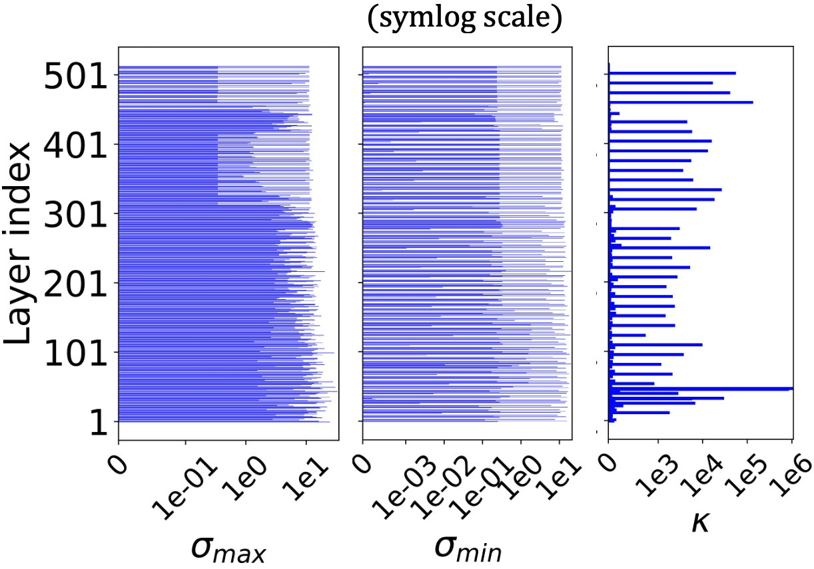
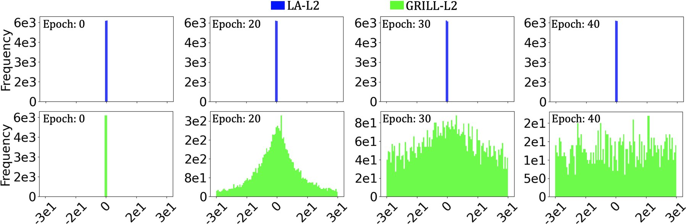
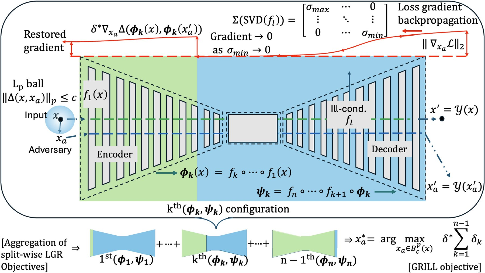
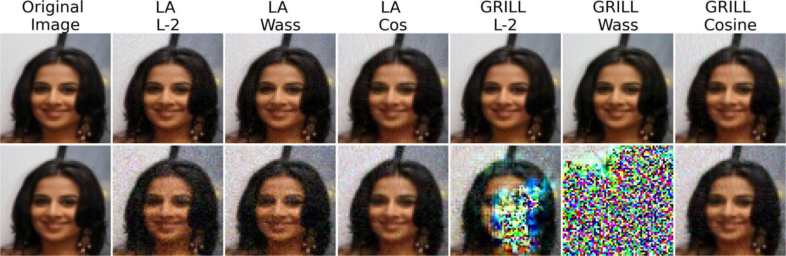
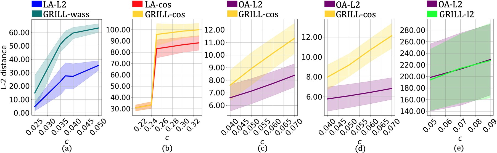
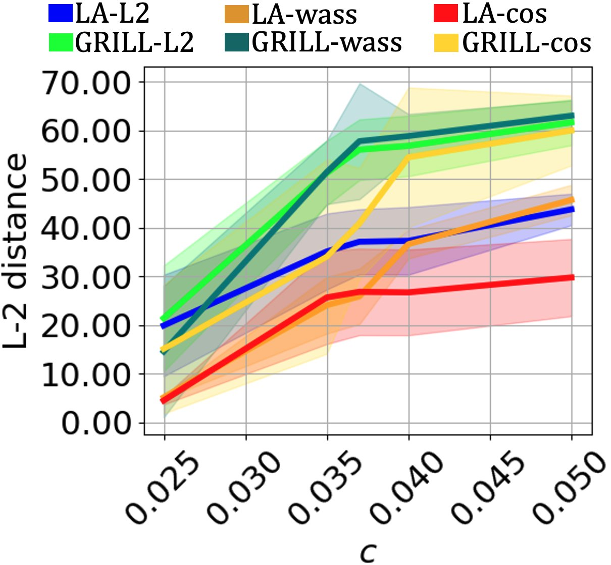
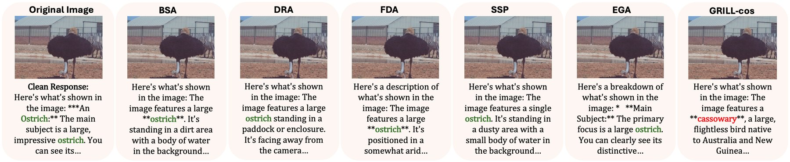

<div class="paper-head">
  <span class="venue">CIKM 2026 · Rome, Italy</span>
  <h1>Revealing Hidden Vulnerabilities in Autoencoders through Gradient Signal Restoration</h1>
  <p class="authors"><strong>Chethan Krishnamurthy Ramanaik</strong>, Arjun Roy, Tobias Callies, Eirini Ntoutsi</p>
  <p class="affil-line">Research Institute CODE, University of the Bundeswehr Munich</p>
  <div class="buttons">
    <a class="primary" href="https://arxiv.org/abs/2505.03646">Read the paper on arXiv</a>
    <a href="https://github.com/ChethanKodase/illcond">Code on GitHub</a>
  </div>
</div>

<div class="tldr">
  <p><strong>TL;DR:</strong> Autoencoders can look robust to adversarial attacks simply because the attacks fail to optimize, not because the models are truly robust. Near-zero singular values in ill-conditioned layers make the attack gradient vanish. We propose <strong>GRILL</strong>, which restores this gradient signal and reveals vulnerabilities that existing attacks miss, in autoencoders and in vision-language models such as Gemma 3 and Qwen 2.5.</p>
</div>

## Motivation: an illusion of robustness

Autoencoders (AEs) are used for image compression, denoising, anomaly detection and generative modelling, often in high-stakes settings. To know how much we can trust them, we test them with **white-box adversarial attacks**: we search for a tiny, norm-bounded perturbation of the input that damages the reconstruction as much as possible. If even a strong attack cannot cause much damage, we call the model robust.

But this conclusion is only as good as the attack. We found that standard attacks on AEs often **stall early and converge to weak perturbations**. The model then looks robust, while a better-optimized attack under the same budget can destroy its output.

## Why attacks fail: vanishing gradients in ill-conditioned layers

Encoder–decoder models compress data into a smaller latent space, so they are **ill-conditioned** by design, and training often makes this worse: some singular values of the layer weights grow large while others shrink toward zero.

Most robustness work focuses on the *large* singular values, which amplify perturbations. We look at the other end. When an attack backpropagates its loss gradient through a layer whose smallest singular value $$\sigma_{\min} \to 0$$, the gradient signal is squashed. By the time it reaches the input, it is close to zero, and gradient-based optimization has nothing to follow.

<div class="fig-row">
  <div><figure><figcaption>NVAE has hundreds of layers with near-zero \( \sigma_{\min} \) and condition numbers up to \( 10^{6} \).</figcaption></figure></div>
  <div><figure><figcaption>The baseline attack's gradients (blue) stay stuck at zero for the whole optimization. GRILL's gradients (green) spread out and stay informative.</figcaption></figure></div>
</div>

## The main idea: GRILL

**GRILL** (Gradient Signal Restoration in Ill-Conditioned Layers) builds on a simple observation: even when the gradient from the output vanishes, layers *before* the ill-conditioned part still carry a useful gradient.

We first combine the latent distortion and the output distortion as a **product** instead of a sum. Through the product rule, the healthy latent gradient is scaled by the output distortion, so the attack still moves in a meaningful direction even when the output gradient has vanished. We call this *Latent Gradient Restoration* (LGR).

Ill-conditioning can occur anywhere in a network, not just in the decoder. So GRILL treats **every layer as a possible split point** between an "encoder" $$\phi_k$$ and a "decoder" $$\psi_k$$, and sums the distortion over all splits, scaled by the final output distortion $$\delta^{*}$$:

$$
x_a^{*} = \arg\max_{x_a \in B_c^p(x)} \; \delta^{*} \sum_{k=1}^{n-1} \delta_k ,
\qquad \delta_k = \Delta\big(\phi_k(x_a), \phi_k(x)\big)
$$

<figure>
  
  <figcaption>The GRILL framework. The gradient vanishes as it passes through an ill-conditioned layer, and GRILL restores it from earlier splits of the network.</figcaption>
</figure>

The multiplicative coupling matters: if we drop $$\delta^{*}$$ and simply add up the layer losses, the attack becomes clearly weaker. GRILL also reuses activations from the normal forward and backward pass, so it costs about the **same number of FLOPs per step** as a standard latent-space attack.

## Results

We tested GRILL on five autoencoders (β-VAE, TC-VAE, NVAE, DiffAE and MAE), against universal and sample-specific attacks, with and without a state-of-the-art defense, and with three distance functions (L2, Wasserstein and cosine).

<div class="stats">
  <div class="stat"><div class="num">+56.7%</div><div class="lbl">more output distortion on NVAE than the strongest baseline</div></div>
  <div class="stat"><div class="num">+102%</div><div class="lbl">on NVAE under an adaptive attack against an HMC defense</div></div>
  <div class="stat"><div class="num">+77.6%</div><div class="lbl">on β-VAE under the same adaptive setting</div></div>
  <div class="stat"><div class="num">≈ same</div><div class="lbl">compute per attack step as a standard latent attack</div></div>
</div>

**The worse the conditioning, the bigger the gain.** On the severely ill-conditioned NVAE, GRILL increases output distortion by 38–57% over the strongest baseline. On DiffAE, whose ill-conditioning is concentrated in the last encoder layer, the gain is 14–16%. On the mildly ill-conditioned models, GRILL matches the best baselines, and on TC-VAE it still beats them by up to 12.7%.

<figure>
  
  <figcaption>Sample-specific attacks on NVAE (\( c = 0.03 \)). Top row: inputs, all visually almost identical. Bottom row: reconstructions. Baseline latent attacks (LA) barely change the output, while GRILL attacks with the same budget destroy it.</figcaption>
</figure>

**GRILL stays strong against defenses.** A Hamiltonian Monte Carlo defense refines latent codes at inference time and strongly suppresses baseline attacks. In the adaptive setting, where the attacker knows about the defense, GRILL is ahead on NVAE, DiffAE, TC-VAE and β-VAE. Only on MAE is there no gain, because the defense is less effective for its deterministic latent space.

<figure>
  
  <figcaption>Adaptive attacks against an HMC defense on (a) NVAE, (b) DiffAE, (c) TC-VAE, (d) β-VAE and (e) MAE. GRILL is shown in teal, yellow and green.</figcaption>
</figure>

<figure class="narrow">
  
  <figcaption>Universal attacks on NVAE. All three GRILL variants pull ahead of the latent-attack baselines as the budget \( c \) grows.</figcaption>
</figure>

## Beyond autoencoders: vision-language models

Large vision-language models have a similar layered encoder–decoder structure, and Gemma 3 and Qwen 2.5 also show widespread near-zero singular values. Applying GRILL to their intermediate representations, with perturbation budgets too small to see, changes what the model says about an image. Existing attacks (BSA, DRA, FDA, SSPA and EGA) only paraphrase the original answer. On Gemma 3, GRILL also achieves lower BERTScore precision and recall than all of these baselines, meaning stronger semantic damage.

<figure>
  
  <figcaption>Gemma 3, asked "What is shown in this image?" (\( c = 0.0006 \)). Under every baseline attack the model still sees an ostrich. Under GRILL it confidently describes a cassowary.</figcaption>
</figure>

## Takeaway

A model that withstands an attack is not necessarily robust: the attack may simply have lost its gradient. **Robustness evaluation needs to be conditioning-aware.** GRILL is a drop-in way to make white-box attacks on encoder–decoder models more reliable, so that we stop overestimating how safe these models are.

<div class="buttons" style="margin-top: 26px">
  <a class="primary" href="https://arxiv.org/abs/2505.03646">Read the full paper on arXiv</a>
  <a href="https://github.com/ChethanKodase/illcond">Get the code</a>
</div>

## Citation

```bibtex
@inproceedings{ramanaik2026grill,
  title     = {Revealing Hidden Vulnerabilities in Autoencoders through Gradient Signal Restoration},
  author    = {Ramanaik, Chethan Krishnamurthy and Roy, Arjun and Callies, Tobias and Ntoutsi, Eirini},
  booktitle = {Proceedings of the 35th ACM International Conference on Information and Knowledge Management (CIKM '26)},
  year      = {2026},
  address   = {Rome, Italy},
  doi       = {10.1145/3799682.3840873}
}
```
