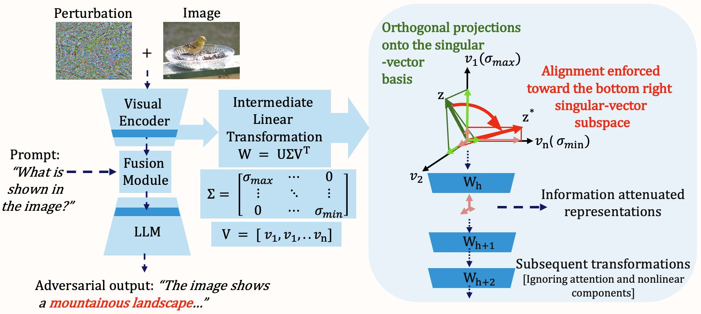
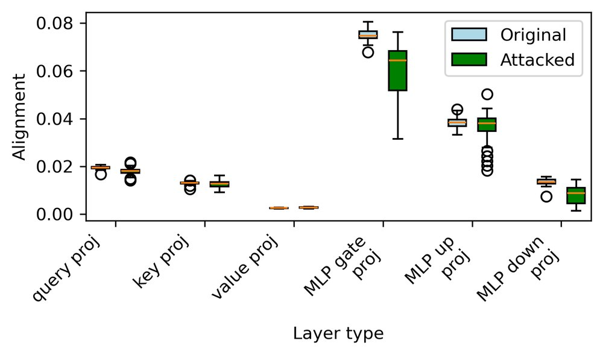
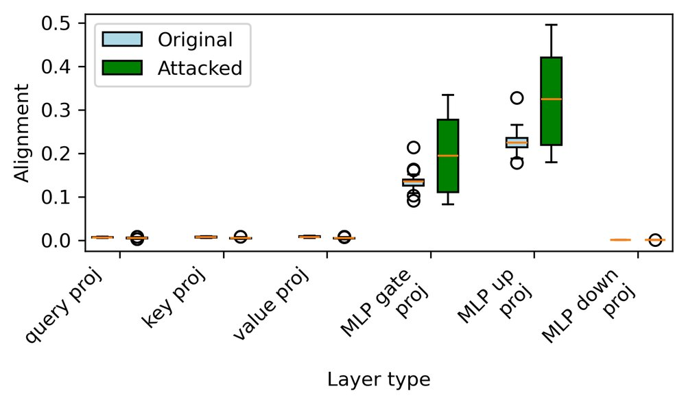
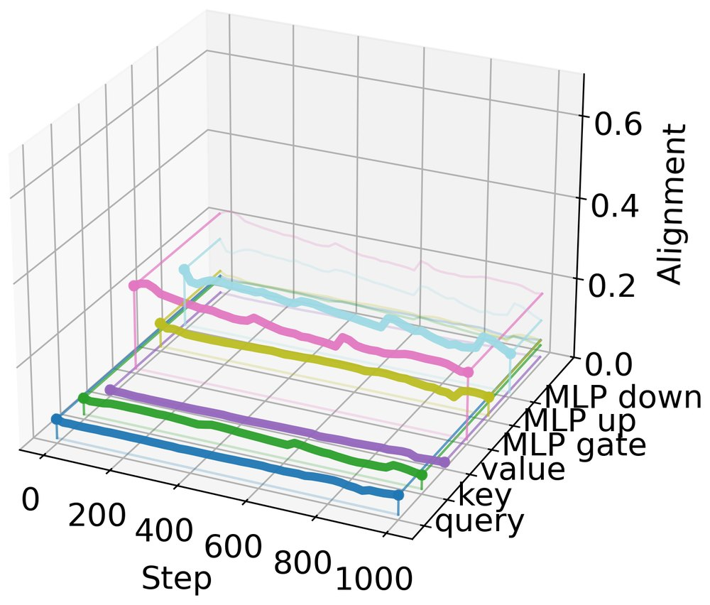
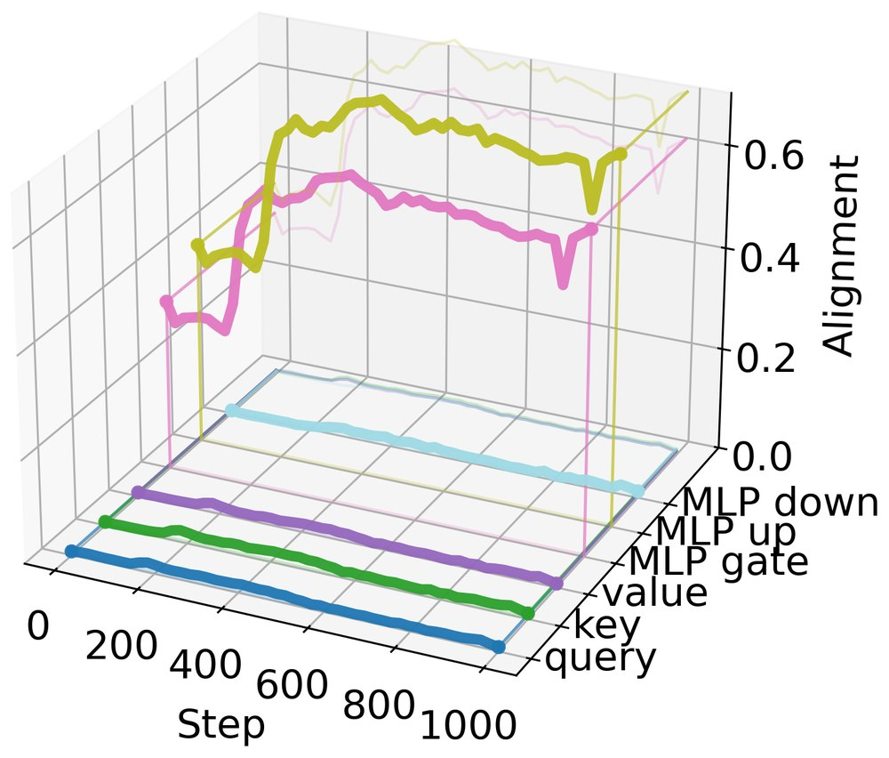
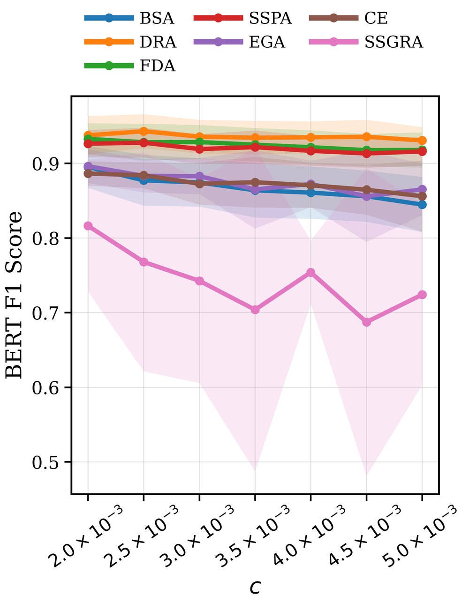
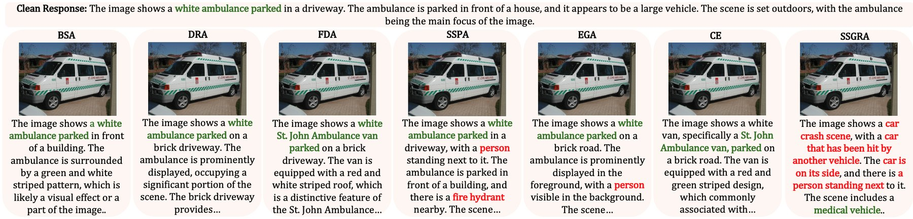
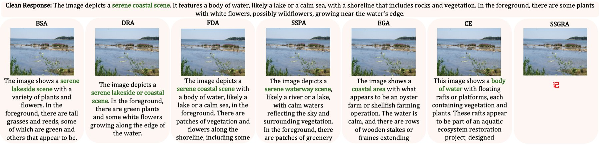
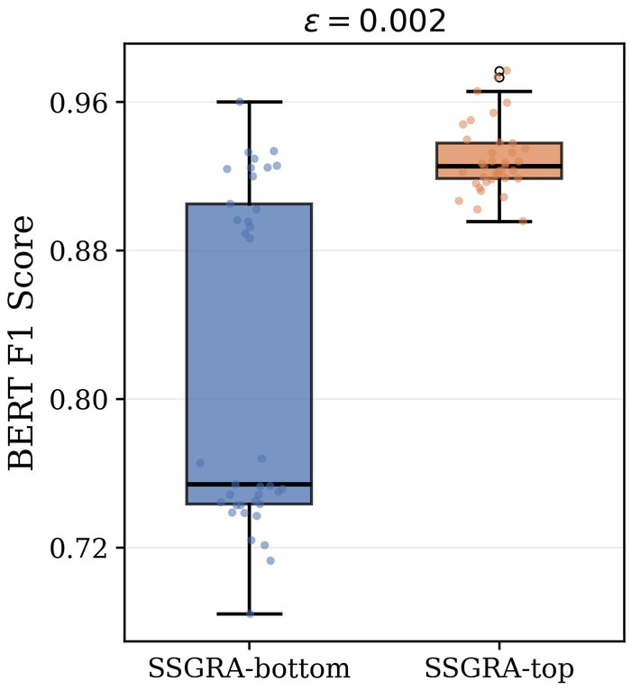

<div class="paper-head">
  <span class="venue">ACCV 2026 · Osaka, Japan</span>
  <h1>On Adversarial Vulnerability of Vision-Language Models through the Lens of Intermediate Spectral Subspaces</h1>
  <p class="authors"><strong>Chethan Krishnamurthy Ramanaik</strong>, Tobias Callies, Michael Hecht, Eirini Ntoutsi</p>
  <p class="affil-line">University of the Bundeswehr Munich · University of Wrocław</p>
  <div class="buttons">
    <a class="primary" href="https://arxiv.org/abs/2607.07375">Read the paper on arXiv</a>
    <a href="https://github.com/ChethanKodase/interpretAttacks">Code on GitHub</a>
  </div>
</div>

<div class="tldr">
  <p><strong>TL;DR:</strong> Inside every transformer layer, some directions are almost erased: the ones belonging to the smallest singular values. We find that adversarial examples for vision-language models naturally push their internal representations <em>toward</em> these information-attenuating directions. Our attack, <strong>SSGRA</strong>, does this on purpose and beats six existing attacks on Qwen2.5-VL, LLaVA-1.5 and Gemma 3 with perturbations too small to see.</p>
</div>

## Motivation: where does an adversarial perturbation do its damage?

Vision-language models (VLMs) such as Qwen2.5-VL, LLaVA and Gemma 3 describe images, answer visual questions and are being built into many products. Like other deep networks, they can be fooled by **adversarial perturbations**: noise too small for a person to notice that changes what the model says.

Existing explanations of this vulnerability look at the input space or at the network as a whole: decision-boundary geometry, non-robust features, input–output Jacobians. What happens **inside** the network, in the many linear layers that carry information from the image to the text, has received much less attention. Most robustness work there focuses on *large* singular values, which amplify perturbations, and keeps them in check with spectral normalization or Lipschitz regularization.

We look at the other end of the spectrum.

## The idea: steer representations into the "blind spots" of each layer

Every linear layer \\( W = U \Sigma V^\top \\) has a set of right singular vectors. Directions with large singular values pass through strongly, while directions with near-zero singular values are almost erased. This is the same mechanism that makes ill-posed inverse problems unstable: information lost along near-null directions cannot be reliably recovered.

So we ask: **if an attacker pushes the model's internal representations into these bottom singular-vector subspaces, does the meaning of the image get lost on its way to the language model?**

<figure>
  
  <figcaption>The spectral view of an attack. A tiny perturbation rotates an intermediate representation \( z \) toward the bottom right singular vectors of a linear layer \( W \) (red arrow). That information is attenuated by the following layers, and the model's answer drifts away from the image.</figcaption>
</figure>

To measure how strongly a set of token representations lies in a subspace, we use the average projection energy \\( \Psi \\), a number between 0 and 1. **SSGRA** (Spectral Subspace Guided Representation Attack) combines two goals:

1. Make the adversarial representations differ from the clean ones in every vision and language block, as in the Blockwise Similarity Attack (BSA).
2. **Maximize the alignment \\( \Psi \\) with the bottom singular-vector subspaces** of selected linear layers, which is the new spectral guidance term.

A weight \\( \lambda \\) balances the two. On Qwen2.5-VL the best setting turned out to be \\( \lambda = 0 \\), so the spectral term alone gave the strongest attack.

## Key finding: attacks already drift toward the bottom subspaces

Before adding any spectral term, we looked at what a standard attack (BSA) does internally on Gemma 3. After the attack, representations at the MLP *gate* and *up* projections are **more aligned with the bottom-10 singular vectors** and *less or equally* aligned with the top-10. Untargeted attacks discover this weakness on their own, and SSGRA makes it explicit.

<div class="fig-row">
  <div><figure><figcaption>Top-10 subspace: alignment stays the same or <strong>drops</strong> after the attack.</figcaption></figure></div>
  <div><figure><figcaption>Bottom-10 subspace: alignment <strong>rises</strong> at the MLP gate and up projections.</figcaption></figure></div>
</div>

The same picture appears over the course of the optimization. During 1,000 attack steps, alignment with the smallest singular vectors climbs in the MLP layers, while alignment with the largest ones stays flat or slowly falls.

<div class="fig-row">
  <div><figure><figcaption>Alignment with the <strong>top</strong> singular vector during the attack.</figcaption></figure></div>
  <div><figure><figcaption>Alignment with the <strong>bottom</strong> singular vector during the attack.</figcaption></figure></div>
</div>

## Results: three VLMs, six baselines, imperceptible budgets

We attacked **Qwen2.5-VL (7B), LLaVA-1.5 (7B) and Gemma 3 (4B)** on ImageNet images with the prompt *"What is shown in the image?"*, using \\( \ell_\infty \\) budgets between 0.002 and 0.005. We compared SSGRA with six attacks: BSA, DRA, FDA, SSPA, EGA and cross-entropy (CE). We measured how far the answer moved from the clean answer with BERTScore (meaning) and ROUGE-L (wording), where lower scores mean stronger attacks.

<div class="stats">
  <div class="stat"><div class="num">up to 19.7%</div><div class="lbl">extra BERTScore F1 drop over the strongest baseline on Qwen2.5-VL</div></div>
  <div class="stat"><div class="num">up to 97.9%</div><div class="lbl">extra ROUGE-L F1 drop over the strongest baseline on Qwen2.5-VL</div></div>
  <div class="stat"><div class="num">up to 18.9%</div><div class="lbl">extra ROUGE-L F1 drop on LLaVA-1.5</div></div>
  <div class="stat"><div class="num">≈ 1 in 4</div><div class="lbl">linear layers in Qwen2.5-VL and LLaVA-1.5 have near-null singular values</div></div>
</div>

<figure class="narrow">
  
  <figcaption>Qwen2.5-VL: BERTScore F1 across perturbation budgets \( c \). SSGRA (pink) is clearly below every baseline.</figcaption>
</figure>

**What it looks like.** With a budget of only \\( c = 0.003 \\), the baselines mostly keep the correct description. SSGRA does not.

<figure>
  
  <figcaption>LLaVA-1.5: every baseline still reports a parked ambulance, while SSGRA makes the model describe a <strong>car crash scene</strong>.</figcaption>
</figure>

<figure>
  
  <figcaption>Qwen2.5-VL: the baselines still describe a coastal or lakeside scene, while under SSGRA the model's answer collapses to a single meaningless character.</figcaption>
</figure>

## Why some models are more vulnerable

We counted how often extreme singular values occur in the non-attention linear layers of each model. **Near-null directions are far more common than strongly amplifying ones**, and the models with the most of them are the ones SSGRA hurts most.

| Model | Layers with \\( \sigma_{\min} < 10^{-3} \\) | Layers with \\( \sigma_{\max} > 10 \\) | SSGRA advantage |
|---|---|---|---|
| Qwen2.5-VL | 24.9% | 18.8% | largest |
| LLaVA-1.5 | 27.7% | 19.4% | large |
| Gemma 3 | 12.2% | 11.3% | smallest |

Qwen2.5-VL and LLaVA-1.5 have about twice as many near-null directions as Gemma 3, so they offer a larger "spectral attack surface". On Gemma 3 the margins are smaller (up to 0.8% BERTScore and 3.1% ROUGE-L), but SSGRA is still the strongest attack in several settings.

## Is it really the bottom subspace that matters?

We ran two ablations on Qwen2.5-VL. **Removing the spectral term** weakens the attack at every budget, and the gap grows with the budget. **Aligning with the top singular subspace instead of the bottom** barely hurts the model, while the bottom-subspace version causes a large drop. The weak spot is the near-null directions, not the amplifying ones.

<figure class="narrow">
  
  <figcaption>Steering toward the bottom subspace (blue) is far more damaging than steering toward the top subspace (orange).</figcaption>
</figure>

## Takeaway

Robustness work has mostly focused on keeping large singular values small. Our results point to the opposite end: **near-null singular directions inside transformer layers are an overlooked attack surface** in vision-language models. Controlling them, alongside existing spectral-norm regularization, may be a complementary route to more robust VLMs.

<div class="buttons" style="margin-top: 26px">
  <a class="primary" href="https://arxiv.org/abs/2607.07375">Read the full paper on arXiv</a>
  <a href="https://github.com/ChethanKodase/interpretAttacks">Get the code</a>
</div>

## Citation

```bibtex
@article{ramanaik2026adversarial,
  title={On Adversarial Vulnerability of Vision-Language Models through the Lens of Intermediate Spectral Subspaces},
  author={Ramanaik, Chethan Krishnamurthy and Callies, Tobias and Hecht, Michael and Ntoutsi, Eirini},
  journal={arXiv preprint arXiv:2607.07375},
  year={2026}
}

```
