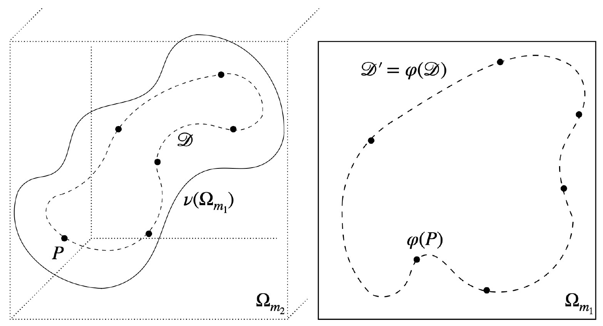
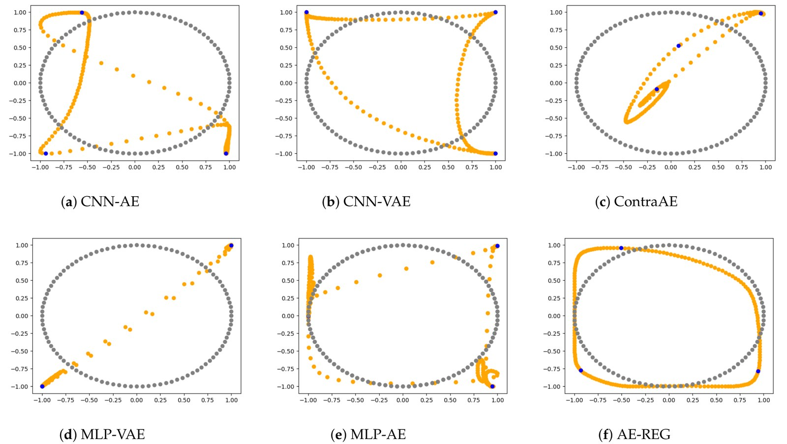
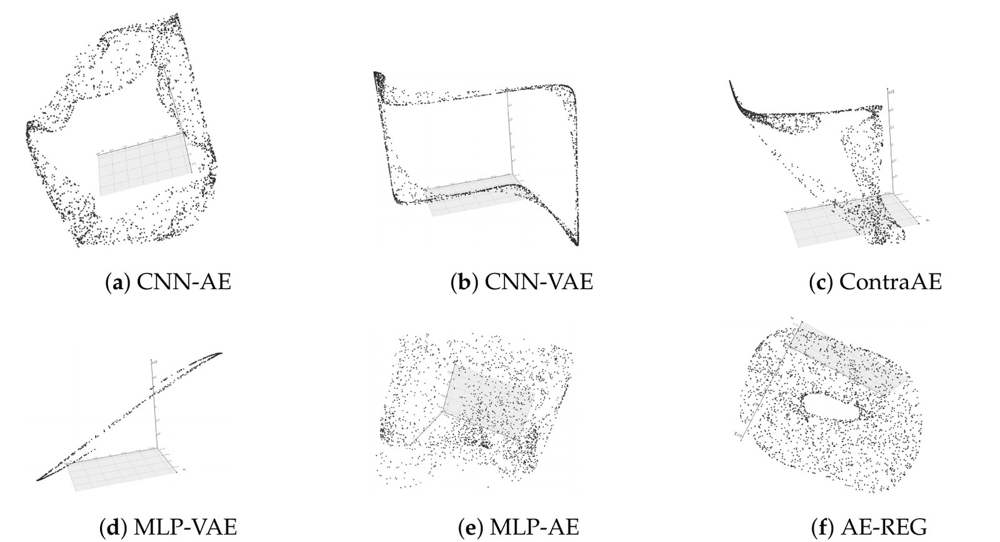
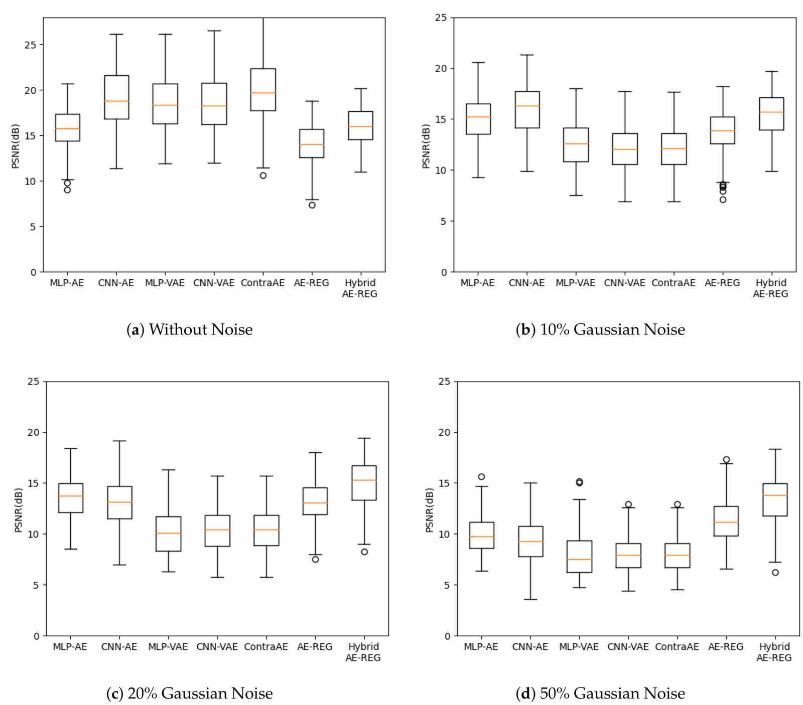
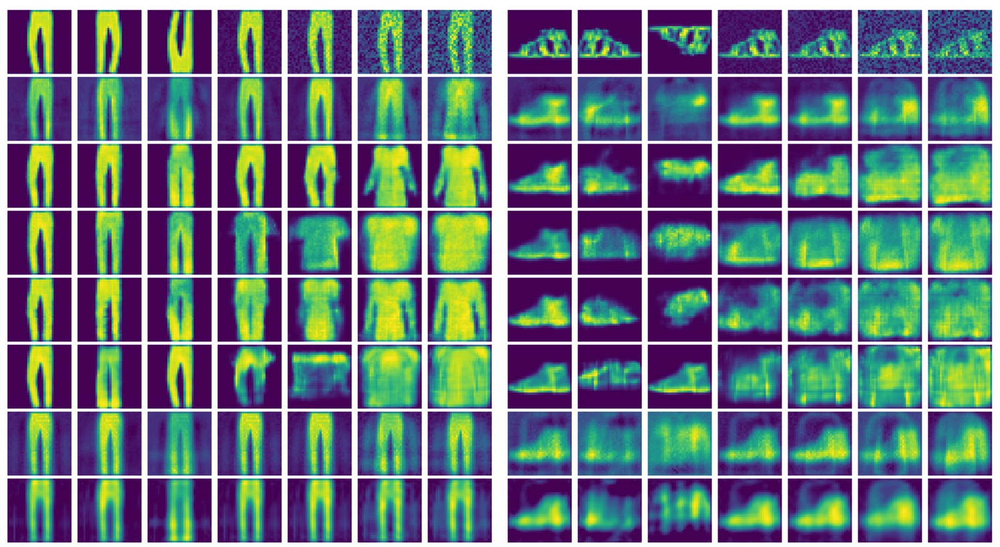
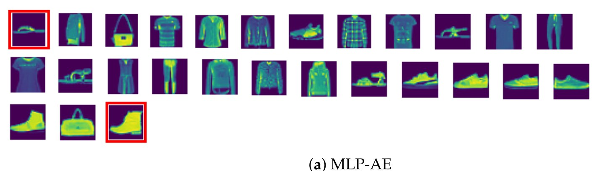
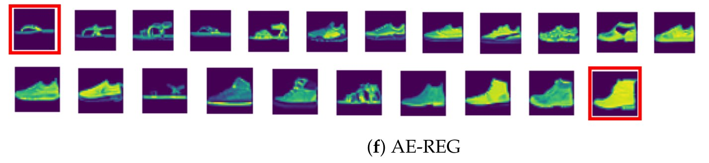

<div class="paper-head">
  <span class="venue">Axioms 2024 · Special Issue on Differential Geometry</span>
  <h1>Ensuring Topological Data-Structure Preservation under Autoencoder Compression Due to Latent Space Regularization in Gauss–Legendre Nodes</h1>
  <p class="authors"><strong>Chethan Krishnamurthy Ramanaik</strong>*, Anna Willmann*, Juan-Esteban Suarez Cardona, Pia Hanfeld, Nico Hoffmann, Michael Hecht</p>
  <p class="affil-line">*Equal contribution · Research Institute CODE (UniBw Munich) · CASUS, Helmholtz-Zentrum Dresden-Rossendorf · SAXONY.ai · University of Wrocław</p>
  <div class="buttons">
    <a class="primary" href="https://doi.org/10.3390/axioms13080535">Read the paper (open access)</a>
    <a href="https://arxiv.org/abs/2309.08228">arXiv</a>
    <a href="https://github.com/casus/autoencoder-regularisation">Code on GitHub</a>
  </div>
</div>

<div class="tldr">
  <p><strong>TL;DR:</strong> A low reconstruction error does not mean an autoencoder has learned the true shape of the data. Its latent space can still tear, fold or self-intersect the data manifold. We propose a simple, <strong>data-independent regularization</strong> that samples the autoencoder's Jacobian at Gauss–Legendre nodes in the latent space, and we <strong>prove</strong> it yields a one-to-one, topology-preserving embedding. In practice, regularized autoencoders keep circles as circles and tori as tori, and stay robust to heavy noise on FashionMNIST and MRI brain scans.</p>
</div>

## Motivation: compression should not break the shape of the data

Autoencoders are the standard tool for compressing high-dimensional data, from microscopy and neuroscience to physics, into a low-dimensional latent space. These latent codes are then used for classification, feature selection and analysis. That only makes sense if the latent space is a **faithful copy of the data manifold**: points that are neighbours in the data stay neighbours in the latent space, and nothing gets glued together or torn apart.

Training only minimizes reconstruction error, and that is **not enough**. The decoder solves an inverse problem, and inverse problems are notoriously unstable: tiny changes to a latent code can produce very different reconstructions. Without extra control, an autoencoder can reconstruct its training data well while its latent space still crosses itself, flattens holes or merges classes.

<figure>
  
  <figcaption>What we want. The data manifold \( \mathcal{D} \) (dashed, left) lives in a high-dimensional space. The encoder \( \varphi \) maps it one-to-one onto its latent copy \( \mathcal{D}' = \varphi(\mathcal{D}) \) (right). The decoder \( \nu \) maps the whole latent cube back to a smooth patch \( \nu(\Omega_{m_1}) \) that contains \( \mathcal{D} \).</figcaption>
</figure>

## The idea: regularize the latent space at Legendre nodes

Our key requirement is that **encoding a decoded latent point gives back the same point**, \\( \varphi(\nu(y)) = y \\), for every \\( y \\) in the latent cube, not just for training data. By the inverse function theorem, this holds if the Jacobian of \\( \varphi \circ \nu \\) is the identity everywhere.

So we add one term to the usual reconstruction loss:

$$
\mathcal{L} = \sum_{x \in D_{\text{train}}} \lVert x - \nu(\varphi(x)) \rVert^2 \;+\; \lambda \sum_{\alpha} \big\lVert I - J\big(\varphi(\nu(p_\alpha))\big) \big\rVert^2
$$

The points \\( p_\alpha \\) are **Gauss–Legendre nodes**, the classic quadrature points used for highly accurate numerical integration. Sampling the Jacobian there approximates an integral over the *entire* latent space very efficiently. Because the nodes live in the small latent space, high-resolution regularization stays cheap.

This regularization has several useful properties:

- It is **data-independent**: it needs no knowledge of the data manifold or how it is embedded.
- It is **architecture-independent**: it can be added to MLPs, CNNs or VAEs.
- It is **provably correct**: we prove that autoencoders trained to zero loss converge to a proper, topology-preserving autoencoder (Theorem 1 in the paper).

We also propose a **hybrid** variant (Hybrid AE-REG). It first compresses each image with a Chebyshev polynomial fit and then trains the regularized autoencoder on the polynomial coefficients, which improves reconstruction quality.

## Results: shapes that stay intact

We compared the regularized autoencoder (**AE-REG**) with an MLP autoencoder, a CNN autoencoder, MLP and CNN VAEs, and a contractive autoencoder (ContraAE), all with parameter counts of similar size.

**A circle in 15 dimensions.** We embedded a circle into 15-dimensional space and trained on only three points, the minimum that determines a circle. Every unregularized model produces overlaps or crossings. **Only AE-REG recovers a clean loop.**

<figure>
  
  <figcaption>2D latent re-embeddings of a circle embedded in 15 dimensions (orange: learned embedding, grey: true circle). Only AE-REG (f) gives a loop without self-intersections.</figcaption>
</figure>

**A torus.** The same story holds for a squeezed torus embedded in 15 and 1,024 dimensions. The VAEs and the CNN autoencoder flatten it, and ContraAE and the MLP autoencoder make it intersect itself. **AE-REG is the only model that keeps the hole.**

<figure>
  
  <figcaption>3D latent re-embeddings of a torus embedded in 15 dimensions. Only AE-REG (f) preserves its ring shape.</figcaption>
</figure>

**FashionMNIST under noise.** With a 10-dimensional latent space, the regularized models are not the best on clean images, but they **stay stable as noise increases**. From 20% Gaussian noise onward, Hybrid AE-REG gives the best reconstructions of all models, and its quality holds up to 70% noise.

<figure>
  
  <figcaption>FashionMNIST reconstruction quality (PSNR, higher is better) with 0%, 10%, 20% and 50% Gaussian noise. The regularized models (the two rightmost boxes) degrade much more slowly than the others.</figcaption>
</figure>

The robustness shows up in the images too. Under heavy noise, the unregularized models **change the item's class**: for example, trousers are reconstructed as a shirt or a dress. AE-REG and Hybrid AE-REG (the bottom two rows) keep trousers as trousers.

<figure>
  
  <figcaption>Top row: inputs with vertical and horizontal flips and 0–70% noise. Rows 2–8: MLP-AE, CNN-AE, MLP-VAE, CNN-VAE, ContraAE, AE-REG and Hybrid AE-REG. Only the last two keep the item's class under strong noise.</figcaption>
</figure>

**Walking through the latent space.** To probe the latent geometry, we computed shortest paths (geodesics) between two encoded images, a sandal and a boot. A faithful latent space should give a smooth path through similar items. The unregularized MLP autoencoder wanders through bags, shirts and trousers. AE-REG moves smoothly from sandals through sneakers to boots.

<figure>
  
  <figcaption>Latent geodesic from sandal to boot for the unregularized MLP autoencoder: it takes a shortcut through unrelated classes.</figcaption>
</figure>

<figure>
  
  <figcaption>The same geodesic for AE-REG: a smooth path through footwear only.</figcaption>
</figure>

**MRI brain scans.** On 60,000 slices from the OASIS MRI dataset (91 × 91 pixels, 40-dimensional latent space), the picture repeats. The regularized models are comparable on clean scans and pull ahead once noise is added. Hybrid AE-REG gives the cleanest reconstructions of perturbed scans, and AE-REG produces the most consistent latent geodesics.

## Takeaway

Low reconstruction error is not the same as a trustworthy latent space. By asking the autoencoder to be invertible across its whole latent space, which we enforce cheaply at Gauss–Legendre nodes, we obtain representations that **provably preserve the topology of the data**. In practice they are also **far more robust to noise**. Even plain MLP autoencoders regularized this way outperform convolutional, variational and contractive alternatives.

<div class="buttons" style="margin-top: 26px">
  <a class="primary" href="https://doi.org/10.3390/axioms13080535">Read the full paper (open access)</a>
  <a href="https://arxiv.org/abs/2309.08228">arXiv</a>
  <a href="https://github.com/casus/autoencoder-regularisation">Get the code</a>
</div>

## Citation

```bibtex
@article{ramanaik2024ensuring,
  title={Ensuring Topological Data-Structure Preservation under Autoencoder Compression Due to Latent Space Regularization in Gauss--Legendre Nodes},
  author={Ramanaik, Chethan Krishnamurthy and Willmann, Anna and Suarez Cardona, Juan-Esteban and Hanfeld, Pia and Hoffmann, Nico and Hecht, Michael},
  journal={Axioms},
  volume={13},
  number={8},
  pages={535},
  year={2024},
  publisher={MDPI}
}
```
