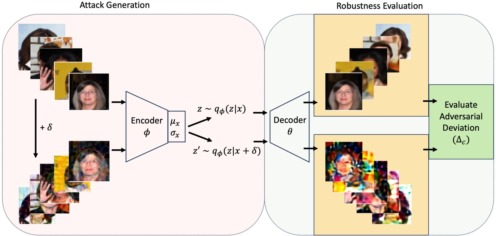
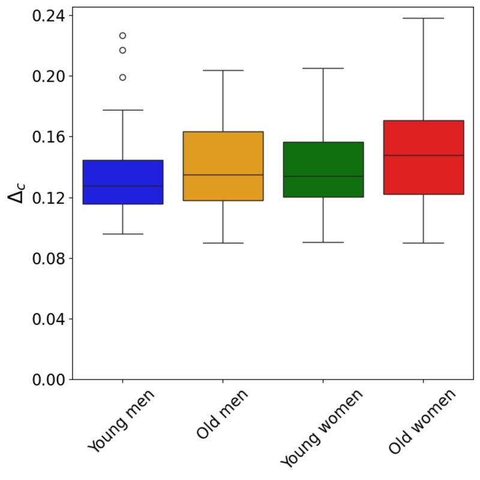
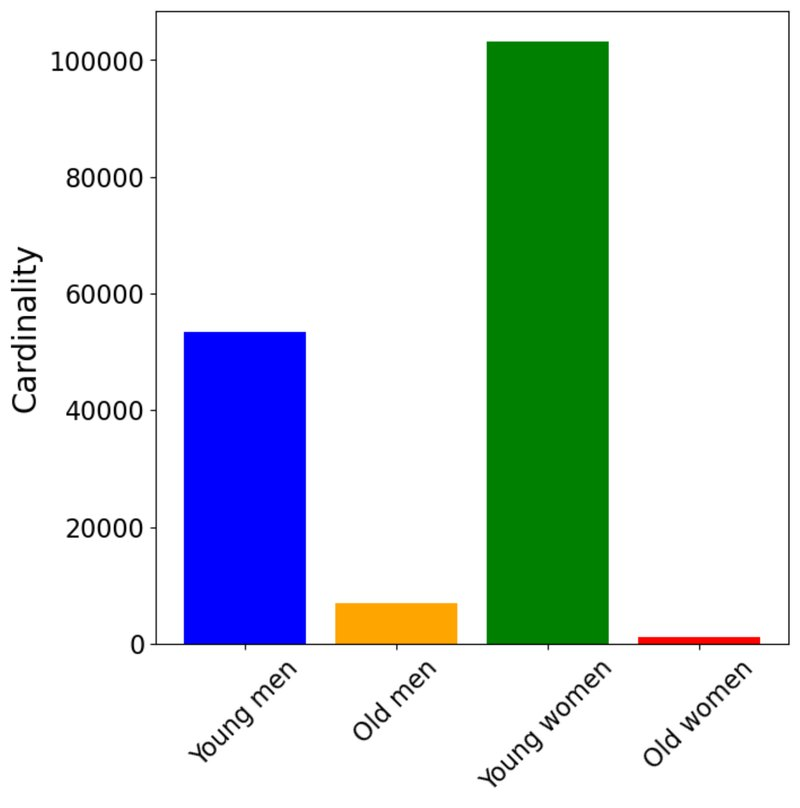
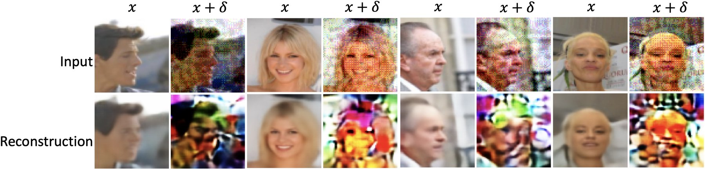
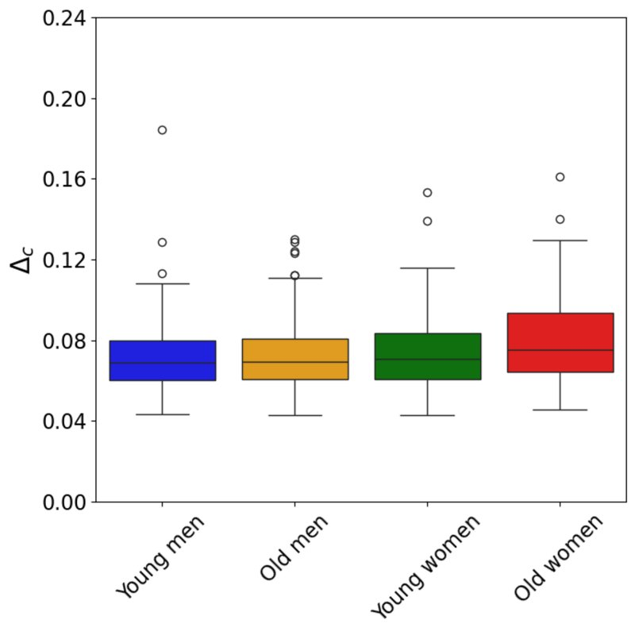
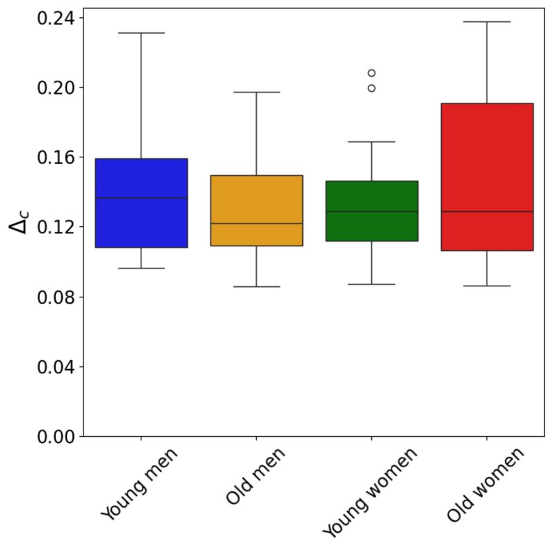
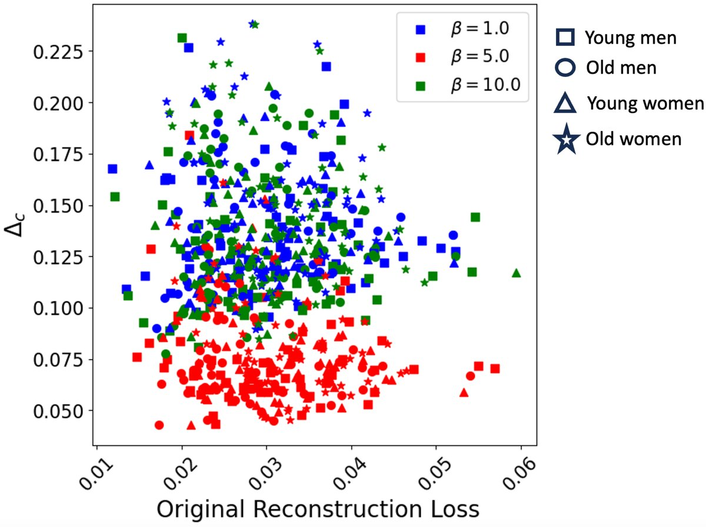
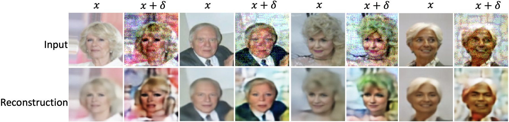
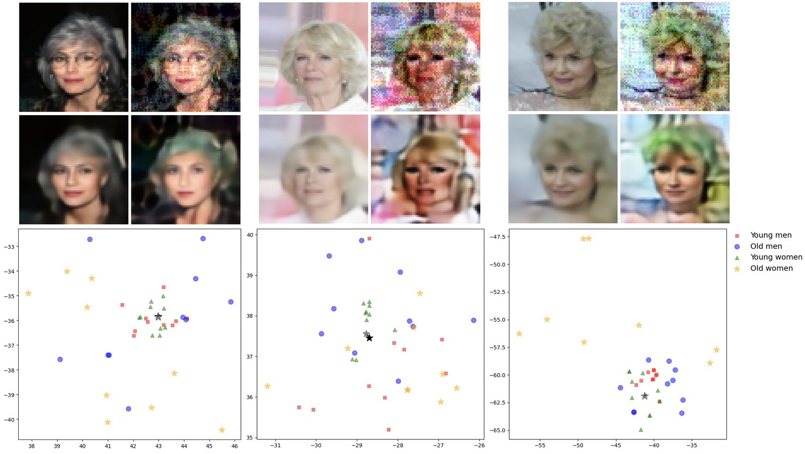

<div class="paper-head">
  <span class="venue">BIAS Workshop · ECML PKDD 2024 · Vilnius</span>
  <h1>Adversarial Robustness of Variational Autoencoders across Intersectional Subgroups</h1>
  <p class="authors"><strong>Chethan Krishnamurthy Ramanaik</strong>, Arjun Roy, Eirini Ntoutsi</p>
  <p class="affil-line">University of the Bundeswehr Munich</p>
  <div class="buttons">
    <a class="primary" href="https://arxiv.org/abs/2407.03864">Read the paper on arXiv</a>
    <a href="https://github.com/ChethanKodase/robustness_of_subgroups">Code on GitHub</a>
  </div>
</div>

<div class="tldr">
  <p><strong>TL;DR:</strong> Is a variational autoencoder equally robust for everyone? We attacked β-VAEs trained on CelebA faces and compared four subgroups defined by age and gender. <strong>Robustness is not equal</strong>: older women, the smallest subgroup, are consistently the most vulnerable. Tuning β helps overall but does not close the gap, and attacks tend to pull minority faces toward the majority groups.</p>
</div>

## Motivation: robustness is also a fairness question

Autoencoders are used for dimensionality reduction, representation learning and image generation. Variational autoencoders (VAEs) are known to be **more robust** to adversarial perturbations than plain autoencoders, but they are not immune: small, carefully crafted changes to an input can still wreck its reconstruction.

At the same time, models trained on real-world face data are known to learn **biased representations** that disadvantage minority groups. Training sets often contain far fewer images of some groups than others. Robustness, however, is almost always reported as a single number for the whole dataset.

We ask two questions:

1. **Are there robustness disparities between demographic subgroups?**
2. **What causes them?** Is it simply how much data each group has, or something about how the model represents them?

## How we evaluate it

We trained three β-VAEs (\\( \beta = 1, 5, 10 \\)) on **CelebA** (202,599 celebrity faces) and split the data into four intersectional subgroups by age and gender: *young men*, *old men*, *young women* and *old women*. The subgroups are heavily imbalanced: young women are the largest group, and old women are by far the smallest.

For 60 random images per subgroup, we ran a **maximum-damage attack**: it searches for a bounded perturbation \\( \delta \\) that pushes the image's latent code as far as possible from the original. We then measured the **adversarial deviation** \\( \Delta_c \\), the distance between the reconstruction of the attacked image and the reconstruction of the clean image. A higher \\( \Delta_c \\) means lower robustness.

<figure>
  
  <figcaption>Our evaluation pipeline. Left: each image receives an adversarial perturbation \( \delta \) that shifts its latent code. Right: we compare clean and adversarial reconstructions and measure the adversarial deviation \( \Delta_c \) for every subgroup.</figcaption>
</figure>

## Finding 1: older subgroups, especially older women, are less robust

With the standard VAE (\\( \beta = 1 \\)), the young subgroups resist attacks better than the old ones. **Old women** show the highest median deviation and the widest spread, followed by old men. They are also the two smallest groups in the data.

<div class="fig-row">
  <div><figure><figcaption>Adversarial deviation per subgroup for the standard VAE (\( \beta = 1 \)). Higher means less robust.</figcaption></figure></div>
  <div><figure><figcaption>Subgroup sizes in CelebA. Old women are by far the smallest group.</figcaption></figure></div>
</div>

<figure>
  
  <figcaption>The most damaging attack in each subgroup for \( \beta = 1 \) (young men, young women, old men, old women). Top: clean and attacked inputs. Bottom: reconstructions.</figcaption>
</figure>

But data size is not the whole story. Looking at single attributes, *men* are more robust than *women* even though there are fewer men in the dataset, while *young* is both larger and more robust than *old*. Group size matters, but it does not decide robustness on its own.

## Finding 2: β helps, but the gap does not close

β controls how strongly a VAE disentangles its latent space. A moderate value, **\\( \beta = 5 \\)**, lowers the adversarial deviation for **every** subgroup. Going further, to \\( \beta = 10 \\), makes robustness as poor as the standard VAE again, with old women hit hardest.

<div class="fig-row">
  <div><figure><figcaption>\( \beta = 5 \): all subgroups become more robust.</figcaption></figure></div>
  <div><figure><figcaption>\( \beta = 10 \): robustness drops again, and old women vary the most.</figcaption></figure></div>
</div>

Even at the best setting, **old women remain the least robust group**. Reconstruction quality also turns out to be a poor guide: some images of older people are reconstructed very well when clean but break down badly under attack.

<figure class="narrow">
  
  <figcaption>Adversarial deviation versus clean reconstruction loss for each \( \beta \). \( \beta = 5 \) (red) is clearly the most robust, but a good clean reconstruction does not guarantee robustness.</figcaption>
</figure>

## Finding 3: attacks pull minority faces toward the majority

Even with \\( \beta = 5 \\), many adversarial reconstructions of older people **look like someone from a majority group**: an older woman comes out looking like a young woman, or an older man like a young man.

<figure>
  
  <figcaption>Subgroup switching at \( \beta = 5 \). The attacked reconstructions (bottom row, columns 2, 4, 6 and 8) drift toward younger-looking faces.</figcaption>
</figure>

We confirmed this with separately trained gender and age classifiers. For old women, gender accuracy falls from **90% on clean images to 58%** on adversarial reconstructions from the standard VAE, the lowest of all groups. Old women also show the largest drop in age-classifier accuracy at \\( \beta = 5 \\).

| Gender classifier accuracy | Clean image | Adversarial reconstruction (\\( \beta = 1 \\)) | Adversarial reconstruction (\\( \beta = 5 \\)) |
|---|---|---|---|
| Young men | 95.0% | 63.3% | 81.7% |
| Old men | 98.3% | 78.3% | 81.7% |
| Young women | 96.7% | 73.3% | 93.3% |
| Old women | 90.0% | **58.3%** | **78.3%** |

**Why does this happen?** When we look at the latent space, the vulnerable images sit in mixed or peripheral neighbourhoods. A small adversarial shift moves an old-woman embedding into a neighbourhood dominated by young women, and the decoder then reconstructs what is common there.

<figure>
  
  <figcaption>The pull effect for three older women. Top: clean and attacked inputs with their reconstructions. Bottom: the clean embedding (black star) and the attacked embedding (grey star) among their nearest neighbours. The attacked point lands among young women (green), and the reconstruction follows.</figcaption>
</figure>

## Takeaway

Adversarial robustness should be **evaluated per subgroup, not only on average**. Under-represented groups such as older women can be markedly more vulnerable, and attacks can quietly turn them into majority-looking reconstructions. Collecting more data alone is not enough, since group size does not fully explain the gap, and disentanglement helps without being a cure. Fair and robust representation learning will likely need both: better representation of small subgroups *and* latent spaces that keep protected attributes well separated.

<div class="buttons" style="margin-top: 26px">
  <a class="primary" href="https://arxiv.org/abs/2407.03864">Read the full paper on arXiv</a>
  <a href="https://github.com/ChethanKodase/robustness_of_subgroups">Get the code</a>
</div>

## Citation

```bibtex
@inproceedings{ramanaik2024vaesubgroups,
  title     = {Adversarial Robustness of Variational Autoencoders across Intersectional Subgroups},
  author    = {Ramanaik, Chethan Krishnamurthy and Roy, Arjun and Ntoutsi, Eirini},
  booktitle = {BIAS Workshop at the European Conference on Machine Learning and Principles and Practice of Knowledge Discovery in Databases (ECML PKDD)},
  year      = {2024},
  address   = {Vilnius, Lithuania}
}
```
